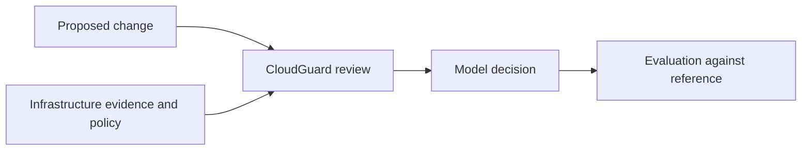

# CloudGuard public demo

CloudGuard studies how a language model evaluates proposed infrastructure changes against scenario evidence and organizational security policy. The evaluated model produces a security decision for each input.



The experiment supplies recorded scenario context to the reviewer. Deployment and enforcement are external to this research harness. Decisions are PROCEED, BLOCK, or HUMAN_REVIEW. Accuracy compares completed decisions with the reference decision. Failures are recorded separately. Reference rationales describe the expected reasoning and model rationales are reported when available.

## Preparing a result

Use Python 3 to prepare a report locally from one directory containing CloudGuard trial JSONL files. Supply a new output filename in a separate directory.

```powershell
python .\prepare_results.py --input-dir "C:\path\to\cloudguard\results\run-folder" --output ".\results\run.json"
```

The script reads trial JSONL files, preserves the explicit or distributed context label from filenames, and calculates overall accuracy over completed trials. It records requested model IDs and provider-returned model identifiers when present. The generated report includes dates, family count, expected and model decisions, rationales, failures, and accuracy.

Inspect the generated report before publishing it. The script does not upload anything. To publish selected output, add and commit that report with Git.

```powershell
git add results/run.json
git commit -m "Add selected experiment results"
git push
```

Results in this repository are research observations. Rationale quality is a separate manual review.
